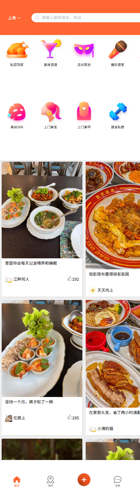

# 逸家生活 · 品质到家服务平台

> 一个「服务者上门」的生活服务交易平台：私厨、调酒师、派对策划、推拿师、美甲师、私教、育婴师到你家来。
> 覆盖浏览、抢购、下单、支付、评价、关注全链路，重点在**用 Redis 解决缓存、并发、计数三类典型问题**。



## 目录结构

```
.
├── backend/     Spring Boot 2.3 + MyBatis-Plus + MySQL + Redis
│   ├── src/
│   ├── tools/gen_seed.py          演示数据生成器（可复现）
│   ├── docs/项目介绍.md            项目定位 / 技术亮点 / 面试口径
│   └── README.md                  后端详细文档（含接口表、排错表）
└── frontend/    Vue 2 + Element UI 移动端 H5（静态站点，Nginx 托管）
    ├── index.html / provider-list.html / note-detail.html ...
    ├── imgs/                      本地图片资源
    └── nginx.conf                 反向代理配置参考
```

## 技术栈

| 层次 | 选型 |
|---|---|
| 后端 | Spring Boot 2.3.12、MyBatis-Plus 3.5.3.2、Lombok |
| 存储 | MySQL 8（业务数据）、Redis 6（缓存 / 锁 / 队列 / GEO / BitMap / HyperLogLog） |
| 中间件 | Redisson（分布式锁）、Lua（库存原子扣减） |
| 前端 | Vue 2 + Element UI + Axios |
| 部署 | Nginx 静态托管 + `/api` 反向代理，JDK 11~24 均可运行 |

## 功能

- **服务发现**：10 个分类、GEO 附近（10km 按距离排序）、名称搜索、热门笔记流
- **交易**：特惠套餐、限时抢购（Lua 原子扣减 + 一人一单）、我的订单、支付、取消（库存回滚）
- **内容**：服务笔记发布、点赞、关注、关注流 Feed
- **互动**：两级评价（回复 / 删除 / 5 秒频控）、评价聚合到服务商
- **用户**：验证码登录（60 秒频控）、个人主页、我的笔记、我的评价、签到
- **运营**：UV 统计（HyperLogLog）、缓存预热、抢购库存预热

## 技术亮点

| 问题 | 方案 |
|---|---|
| 缓存穿透 / 击穿 / 雪崩 | 空值缓存、逻辑过期 + 互斥重建、TTL 打散 + 启动预热 |
| 秒杀超卖 / 重复下单 | Lua 脚本原子校验扣减、阻塞队列异步下单、Redisson 锁 |
| 附近的服务商 | Redis GEO，10km 半径按距离排序分页 |
| 点赞 / 关注 | Set 去重 + ZSet 时间排序 + 收件箱 Feed |
| 签到 | BitMap，一个月仅 4 字节 |
| UV 统计 | HyperLogLog，10 万人误差 0.34%、内存 14.4KB（同规模 Set 需 5.3MB） |
| 订单状态机 | 待支付 → 已支付 / 已取消，取消时回滚库存并释放 Redis 标记 |

## 快速开始

### 1. 初始化数据库

```bash
mysql -uroot -p -e "CREATE DATABASE yijia DEFAULT CHARACTER SET utf8mb4 COLLATE utf8mb4_general_ci;"
mysql -uroot -p --default-character-set=utf8mb4 yijia < backend/src/main/resources/db/yijia-schema.sql
mysql -uroot -p --default-character-set=utf8mb4 yijia < backend/src/main/resources/db/yijia-seed.sql
```

### 2. 启动后端

```bash
cd backend
mvn spring-boot:run          # 默认 8083
```

数据库/Redis 地址在 `backend/src/main/resources/application.yaml`，也可用环境变量覆盖：
`REDIS_HOST` / `REDIS_PORT` / `REDIS_PASSWORD` / `YIJIA_UPLOAD_DIR`。

### 3. 启动前端

把 `frontend/` 放到 Nginx 的 `html` 目录，用仓库里的 `frontend/nginx.conf` 做参考：

```nginx
server {
    listen 8088;
    location / { root html/yijia; index index.html; }
    location /api { rewrite /api(/.*) $1 break; proxy_pass http://127.0.0.1:8083; }
}
```

访问 `http://localhost:8088`，用手机号 `13800138000` 登录（验证码从 Redis 的 `login:code:{手机号}` 取）。

## 文档

- [后端详细文档](backend/README.md)：接口表、缓存策略、抢购流程、常见启动问题
- [项目介绍](backend/docs/项目介绍.md)：业务背景、架构、技术亮点、面试口径

## 说明

项目在经典「点评类」教学项目基础上重构而来：业务域从到店餐饮换成到家服务，领域模型（Shop→Provider、Blog→Note、Voucher→Deal）、接口路径、表名与演示数据全部重写，并补充了订单中心、两级评价、写接口鉴权、验证码频控、缓存预热等能力。
