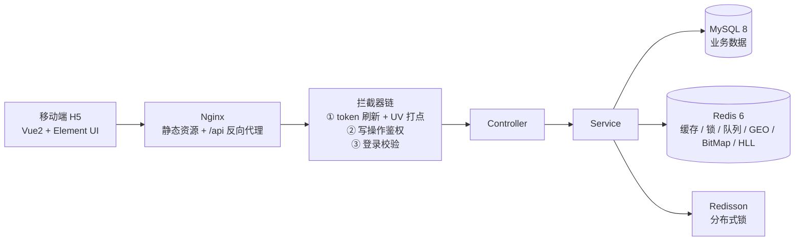

# 逸家生活 · 项目介绍

> 一份可以直接用于简历、面试自述和项目讲解的材料。文末附「30 秒版 / 2 分钟版」口述稿和常见追问。

---

## 一、一句话介绍

**逸家生活是一个「上门服务」的生活服务交易平台**：用户在线浏览服务商、抢限时套餐、下单支付，服务者按约上门；平台侧覆盖商户展示、内容种草、交易履约、评价互动全链路。

和美团、大众点评的区别在于：**它卖的不是"到店消费"，而是"服务者上门"**——私厨、调酒师、派对策划、推拿师、美甲师、私教、育婴师到你家来。

---

## 二、项目背景

到店类平台的瓶颈是"位置和翻台率"，到家类平台的瓶颈是**服务者的时间与信任**：

- 用户不敢随便让陌生人进门 → 需要**服务商档案 + 真实服务笔记 + 评价**建立信任；
- 服务者的档期有限 → 需要**限时抢购**制造稀缺、平滑排期；
- 服务是非标的 → 需要**套餐 + 规则说明 + 评价**把非标服务标准化。

所以这个项目的业务设计围绕三件事：**建档（服务商/套餐）→ 种草（笔记/评价）→ 履约（抢购/订单）**。

---

## 三、功能全景

| 模块 | 能力 |
|---|---|
| 服务发现 | 10 个服务分类、按商圈 GEO 附近查询（10km、按距离排序）、名称搜索、热门笔记流 |
| 服务商 | 详情页（评分/销量/服务时间/相册）、名下套餐、名下所有笔记的评价聚合 |
| 交易 | 特惠套餐、限时抢购（库存 + 一人一单）、我的订单、支付、取消（库存回滚） |
| 内容 | 发布服务笔记、点赞、关注/取关、关注流（Feed）、笔记详情 |
| 互动 | 两级评价（可回复、可删除、5 秒频控）、评价数原子自增 |
| 用户 | 手机验证码登录（60 秒频控）、个人主页、我的笔记、我的评价、签到 |
| 运营 | UV 统计（HyperLogLog）、缓存预热、抢购库存预热 |

---

## 四、技术架构



**技术栈**

| 层次 | 选型 |
|---|---|
| 后端 | Spring Boot 2.3.12、MyBatis-Plus 3.5.3.2、Lombok |
| 存储 | MySQL 8（业务）、Redis 6（缓存/计数/锁/队列） |
| 中间件 | Redisson（分布式锁）、Lua 脚本（原子扣减） |
| 前端 | Vue 2 + Element UI + Axios（移动端 H5） |
| 部署 | Nginx 静态托管 + 反向代理，JDK 11~24 均可运行 |

---

## 五、六个技术亮点（都有实测数据）

### 1. 缓存三件套，一个 `CacheClient` 全覆盖

| 问题 | 方案 | 落地 |
|---|---|---|
| 缓存穿透 | 空值缓存 | 查不到写空串，TTL 2 分钟 |
| 缓存击穿（热点 key） | 互斥锁重建 / 逻辑过期 | 服务商详情走逻辑过期，物理不过期、异步重建 |
| 缓存雪崩 | TTL 打散 + 启动预热 | 启动把热门服务商写进 Redis（几十家，百毫秒级） |

> 踩过的坑：逻辑过期方案默认"key 一定存在"，缓存缺失时若不回源，会把正常数据误判成"不存在"。项目里补了「缺失 → 回源 → 写缓存」和「DB 也没有 → 写空值」两条分支。

### 2. 限时抢购：Lua + 异步下单，扛瞬时并发

```
请求 → Lua（库存校验 + 一人一单 + 扣减，原子完成）→ 投递阻塞队列 → 立即返回订单号
                                                        ↓
                                      单线程消费 + Redisson 锁 + 事务落库
```

- **不超卖**：库存判断和扣减在 Redis 单线程里原子完成；
- **不重复**：`SISMEMBER` 标记已下单用户，重复请求直接返回「不能重复下单」；
- **不阻塞**：写库交给消费线程，接口响应不等数据库；
- **事务生效**：消费线程里 ThreadLocal 已失效，提前取好 AOP 代理。

### 3. 附近的服务商：Redis GEO

商户坐标写入 GEO，按 `GEOSEARCH` 由近到远返回并回填距离。**服务半径取 10km**——到家服务的技师通勤半径比到店餐饮大，5km 会把大部分服务商挡在外面。

### 4. 点赞与关注：Set 去重 + ZSet 排序

- 点赞用 Set（`SISMEMBER` 天然幂等），"我赞过的"用 ZSet（score=时间戳，按时间倒序分页）；
- 关注双写（MySQL + Redis Set），支持"是否关注""共同关注"；关注流用 ZSet 收件箱按时间滚动拉取。

### 5. 签到：BitMap，一个月 4 字节

`sign:{userId}:{yyyyMM}`，`SETBIT` 按日写位，`BITFIELD GET u{day}` 一次取出本月位串，再从低位往高位数连续 1。跨月靠 key 里的 `yyyyMM` 天然隔离。

### 6. UV 统计：HyperLogLog

| 方案 | 规模 | 结果 | 内存 |
|---|---|---|---|
| HyperLogLog | 10 万 | 99,659（误差 0.34%） | **14.4 KB** |
| Set | 10 万 | 100,000（精确） | 5.3 MB |
| HyperLogLog | 100 万 | 991,884（误差 0.81%） | **14.4 KB** |

同样 10 万人，Set 内存是 HLL 的 **387 倍**；HLL 从 10 万涨到 100 万，内存几乎不变。

### 7. 订单中心：状态机 + 库存回滚

待支付(1) → 已支付(2) / 已取消(4)。取消时「改订单状态 + 库存 +1」在同一个事务里；Redis 的一人一单标记放在事务内但用 try-catch 兜底——库存以数据库为准，Redis 失败只记日志，重启预热会对齐。支付用 `where status = 1` 的条件更新，天然防并发重复支付。

---

## 六、数据与演示

演示数据由 `tools/gen_seed.py` 生成（固定随机种子，可复现）：

| 表 | 数量 | 说明 |
|---|---|---|
| 服务分类 | 10 | 私厨/调酒/派对/轰趴/推拿/SPA/美发/美甲/私教/育婴 |
| 服务商 | 60 | 分布在 20 个上海真实商圈，坐标可用于 GEO |
| 套餐 | 120 | 每商户 2 个，含价格、规则 |
| 限时抢购 | 20 | 库存 30~200，时间用 `NOW()` 计算，导入即进行中 |
| 服务笔记 | 90 | 每个商户 1~2 篇，配本地图片 |
| 服务评价 | 900 | 每篇 6~14 条，含二级回复 |
| 用户 / 关注 | 40 / 160 | 粉丝数、关注数按真实关系计算 |

一致性保证：`t_note.comments` = 真实评价数、`t_provider.comments` = 名下评价之和、图片 100% 命中本地资源。

---

## 七、工程规范

- **统一返回**：`Result{success, errorMsg, data, total}`，全局异常兜底，不把堆栈抛给前端；
- **拦截器分层**：token 刷新（顺带 UV 打点）→ 写操作鉴权 → 登录校验，白名单只放行浏览类接口；
- **脚本与数据分离**：`yijia-schema.sql` 只有结构，`yijia-seed.sql` 只有数据；
- **可复现**：种子数据生成器 + `pom.xml` 固定依赖版本 + README 排错表。

---

## 八、面试口径

### 30 秒版

> 逸家生活是一个到家服务交易平台，业务上把「到店消费」换成了「服务者上门」，技术上用 Spring Boot + Redis 撑起浏览、抢购、下单、评价全链路。我做得最深的是三块：缓存的三类问题（穿透/击穿/雪崩）、秒杀的超卖与重复下单、以及订单取消后的库存回滚。项目里 60 个服务商、900 条评价都是脚本生成的可复现数据。

### 2 分钟版

> 1）**业务**：到家和到店最大的区别是"信任"和"档期"。所以做了服务商档案 + 服务笔记 + 评价建立信任，用限时抢购平滑服务者档期。
>
> 2）**技术**：整体是 Nginx + Spring Boot + MySQL + Redis。缓存层封装了一个 `CacheClient`，按数据特点分三种策略：普通详情用空值缓存防穿透，热点服务商用逻辑过期防击穿，分类这种低频变更的直接 TTL 缓存。
>
> 3）**难点一（秒杀）**：一开始是"查库存-扣库存-下单"三步，压测直接超卖。后来把校验和扣减写成 Lua 脚本在 Redis 里原子执行，再把写库放到阻塞队列由单线程消费，接口只返回订单号。重复下单用 Set 标记，配合 Redisson 锁保证多实例下也不会重复建单。
>
> 4）**难点二（缓存击穿）**：热点商户缓存过期瞬间，几百个请求同时打到数据库。改成逻辑过期——value 里带过期时间、物理不过期，过期后只让拿到锁的线程异步重建，其他请求继续读旧值。后来发现缓存被淘汰时会误判"商户不存在"，又补了缺失回源。
>
> 5）**难点三（订单取消）**：取消要同时改订单状态、回滚库存、清 Redis 标记。前两个在事务里，Redis 操作放在事务提交后并 try-catch，失败了只记日志——因为库存以数据库为准，重启预热会对齐。
>
> 6）**数据**：所有演示数据是脚本生成的，固定种子，改完重跑，避免"演示时数据对不上"。

### 可能被追问的 5 个问题

| 问题 | 回答要点 |
|---|---|
| 为什么用逻辑过期而不是互斥锁？ | 逻辑过期不阻塞请求、可用性高，代价是可能读到旧数据；商户详情能接受短暂不一致，所以选它 |
| Lua 里为什么先判重复再判库存？ | 库存抢空后，已下单用户应该看到"重复下单"而不是"库存不足"，提示更准确 |
| 队列在 JVM 里，重启丢单怎么办？ | 承认这是单机方案，生产要换 Redis Stream / RocketMQ；代码里投递和消费已分离，替换成本低 |
| 缓存和数据库怎么保证一致？ | 先更库再删缓存 + 逻辑过期兜底，接受最终一致；强一致场景要上分布式事务或订阅 binlog |
| 为什么不用 Elasticsearch 做搜索？ | 当前数据量 MySQL 模糊查询够用，加 ES 会增加运维成本；数据量上百万或需要分词排序时再引入 |

---

## 九、演进说明（被问"和点评类项目什么关系"时）

这个项目是从经典的「点评类」教学项目**重构**而来，不是简单改包名：

- **业务域**：到店餐饮 → 到家服务（私厨/调酒/派对/推拿/美业/私教/育婴）；
- **领域模型**：Shop→Provider、Blog→Note、Voucher→Deal、VoucherOrder→DealOrder，接口路径与表名全部重写；
- **数据**：杭州餐厅数据整体替换为上海服务商数据，60 商户 / 900 评价全部由脚本生成；
- **功能扩展**：补了订单中心（列表/支付/取消/库存回滚）、两级评价、写接口鉴权、验证码频控、缓存预热；
- **技术升级**：MyBatis-Plus 升到 3.5.3.2（解决 JDK 17+ 反射限制），GEO 服务半径按到家场景调整。

如实说明"基于教学项目重构并扩展"，比包装成从零开始更稳——面试官真正想看的是你对缓存、并发、一致性的理解，而不是业务是谁想的。
